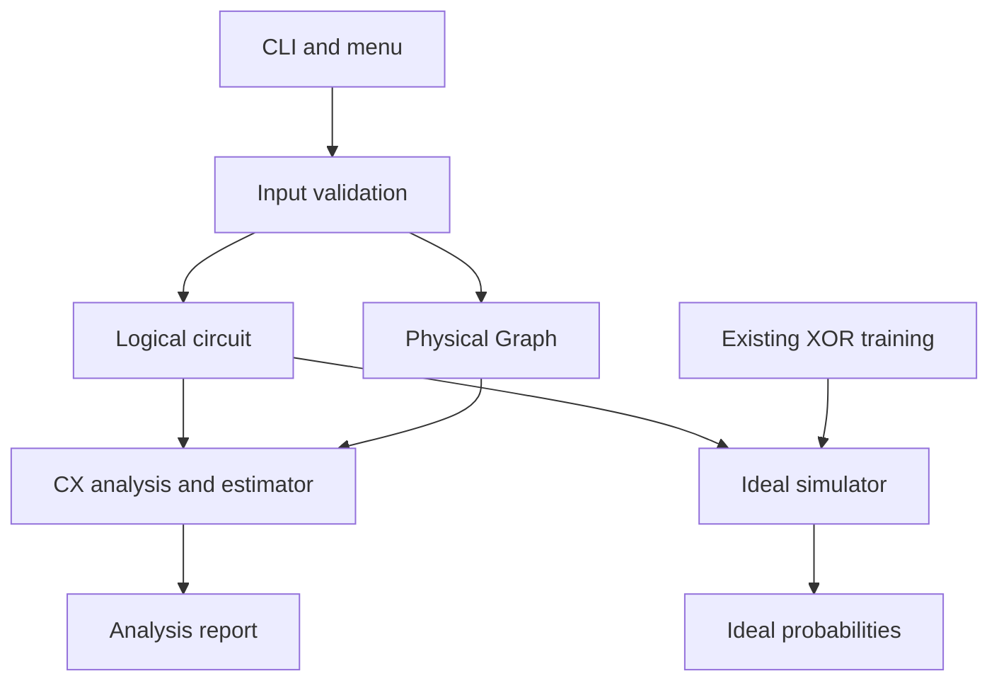

# DOC-05 — Software Design Description

## 1. Authority and design boundary

This SDD settles implementation architecture and interfaces for DOC-04. The student instructed the assistant to perform the next planning step after the review recommended proceeding to DOC-05. That instruction authorizes this design document; it does not authorize production implementation or imply that this new design is already approved.

DOC-01's rubric, DOC-02's narrowed direction, DOC-03's approved scope, all `SRS-04-*` requirements, and the seven review conditions remain authoritative. This document adds `DES-05-*` design IDs without renumbering earlier requirements. It references existing input grammars, limits, fixtures, numerical tolerances, and evidence rather than reproducing them in full.

The unchanged source baseline is commit `eff9baaea6a08c22cd317449a18b89894ef020dd`; `a.c` SHA-256 is `cbf9846fdb646a1b850023b62b0086e92cca379a97298183b0bb236ae7386f87`. The working tree was checked again for this design and remained clean. `baseline-evidence.zip` and DOC-04 §2 contain the bounded verification results. No new algorithm/model result or performance claim is made here.

All declarations and algorithms below are **proposed design contracts**, not code added to the repository. Implement only after the documentation approval gate. No CUDA, hardware backend, full routing/transpilation, manual CX-list input, optimizer replacement, graph GUI, or runtime benchmarking infrastructure is introduced.

## 2. Architecture and exact proposed source layout

**DES-05-01 — Separate the four application concepts.** A logical circuit owns ordered gates; the physical Graph owns connectivity; analysis produces path/cost records; ideal simulation evolves the logical state. Only the orchestration layer selects workflows. The ideal simulator and QML modules must not include Graph or analysis headers.



The following files are the selected layout, not alternatives for the implementation agent to choose between. Headers expose only the interfaces specified here. File names are relative to the repository root.

| File(s) | Responsibility | Allowed project dependencies |
|---|---|---|
| `a.c` | `main`, existing menu adapters, batch argument dispatch, analysis serialization, and top-level diagnostics | All public modules |
| `common.h`, `common.c` | Limits, statuses/diagnostics, checked size arithmetic, project allocation wrappers | Standard C library only |
| `circuit.h`, `circuit.c` | Gate types, ordered operations, logical-circuit invariants and storage ownership | `common.h` |
| `input.h`, `input.c` | Bounded text loading/tokenization, strict shared gate parser, circuit/topology loaders, terminal line reading | `common.h`, `circuit.h`, `graph.h` |
| `graph.h`, `graph.c` | Physical adjacency lists, adjacency queries, deterministic BFS, path results | `common.h` |
| `analysis.h`, `analysis.c` | Actual CX extraction, identity-mapping checks, pure cost calculation, aggregate analysis ownership | `common.h`, `circuit.h`, `graph.h` |
| `sim.h`, `sim.c` | Existing complex statevector arithmetic, guarded normalization, ideal execution and probability display | `common.h`, `circuit.h`; libm |
| `qml.h`, `qml.c` | Existing forward pass and XOR trainer, explicit result/error plumbing, encoding-only verification control | `common.h`, `circuit.h`, `sim.h`; libm |
| `Makefile` | Production and verification build targets in §11 | Compiler, make, libm; Python for verification only |
| `tests/`, `examples/`, `docs/` | Planned verification sources, fixed experiment files, and project documents | As described in §§11–13 |

Each extra module has one application responsibility. `common` is a small shared support layer, not an SDK framework; no plugin system, generic dependency-injection container, or additional runtime library is needed. Production application code remains C.

### 2.1 Migration map from the pinned `a.c`

**DES-05-02 — Move working arithmetic, replace only identified behavior defects.**

| Existing source element | Selected destination/treatment |
|---|---|
| `PI` | `PQC_PI` constant in `common.h`, same literal value |
| `struct gt` | `Gate` in `circuit.h`; preserve numeric gate kinds and explicitly named operand fields |
| `struct cx`, `struct st` | `Complex`/`SimState` in `sim.h`; checked size types and usability flag |
| `make_st`, `free_st` | `sim_create`, `sim_destroy`; enforce preallocation cap and propagate allocation failure |
| `app_gt` gate branches | `sim_apply_gate`; retain formulas, order, and qubit indexing; add status and numerical checks |
| `norm`, `get_o`, `pr_p`, `pr_gt` | Guarded normalization and `sim_odd_probability`, `sim_write_probabilities`, `sim_write_gate` |
| `get_gt` | Strict `input_parse_gate`, reused by file and interactive paths; replace permissive `sscanf` acceptance |
| `r_fl` | File adapter in `a.c`: load complete Circuit, then execute ideal simulation |
| `r_cmd` | Interactive adapter in `a.c`: bounded line input and the same strict gate parser |
| `fwd` | `qml_forward`; retain generated gate order and stop returning ordinary probability zero on failure |
| `trn`, `p_exp` | `qml_train_xor` and its progress output, called by a thin legacy menu adapter |
| `main` | Remains in `a.c`, changed to `int main(int argc, char **argv)` for specified batch/help entry points |

Do not keep parallel old/new gate engines or trainers. Regression means validated gate/model behavior and existing supported modes, not byte-identical malformed-input behavior or the old single-file build command. The updated build command must be documented.

## 3. Shared statuses, diagnostics, limits, and memory

**DES-05-03 — Use explicit status returns and non-owning diagnostics.** The following is the public `common.h` contract. Include guards are normative; the declarations can be syntax-checked independently of any implementation.

```c
/* common.h */
#ifndef PQC_COMMON_H
#define PQC_COMMON_H
#include <stdbool.h>
#include <stddef.h>
#include <stdint.h>
#include <stdio.h>

#define PQC_PI 3.14159265358979323846
#define PQC_MAX_LOGICAL_QUBITS 30u
#define PQC_MAX_SIM_QUBITS 20u
#define PQC_MAX_INTERACTIVE_QUBITS 10u
#define PQC_MAX_VERTICES 64u
#define PQC_MAX_GATES 10000u
#define PQC_MAX_EDGE_ROWS 10000u
#define PQC_MAX_FILE_BYTES 1048576u
#define PQC_MAX_LINE_BYTES 255u
#define PQC_NUMERIC_TOL 1e-10

typedef enum {
    PQC_OK = 0, PQC_E_USAGE, PQC_E_FORMAT, PQC_E_RANGE,
    PQC_E_MAPPING, PQC_E_IO, PQC_E_LIMIT, PQC_E_ALLOC,
    PQC_E_NUMERIC, PQC_E_INTERNAL
} PqcStatus;

typedef struct {
    PqcStatus code;
    const char *file;
    size_t line;
    char message[192];
} Diagnostic;

void pqc_diag_clear(Diagnostic *d);
void pqc_diag_set(Diagnostic *d, PqcStatus code, const char *file,
                  size_t line, const char *format, ...);
const char *pqc_status_name(PqcStatus code);
int pqc_exit_code(PqcStatus code);
PqcStatus pqc_diag_print(FILE *stream, const Diagnostic *d);
bool pqc_size_add(size_t a, size_t b, size_t *out);
bool pqc_size_mul(size_t a, size_t b, size_t *out);
void *pqc_malloc(size_t bytes);
void *pqc_calloc(size_t count, size_t element_size);
void *pqc_realloc(void *pointer, size_t bytes);
void pqc_free(void *pointer);

#ifdef PQC_TESTING
void pqc_test_fail_alloc_on(size_t attempt);
size_t pqc_test_alloc_attempts(void);
size_t pqc_test_live_blocks(void);
#endif
#endif
```

`Diagnostic.file` borrows an argv string or caller-owned filename for the lifetime of the diagnostic; it must never point into a freed text buffer. `line=0` means no physical line is applicable. Messages copy formatted details into the fixed array and terminate safely. Diagnostics allocate no memory. The enum values are internal codes, not process exit numbers; map them to DOC-04 §6.3 exactly. Print status names without the `PQC_` prefix, e.g. `E_FORMAT`.

On a non-OK return, functions with a diagnostic output must set it. Top-level entry points clear their diagnostic before each operation. Nested errors retain the primary failure; a loader may attach its borrowed filename/source line when a lower-level validator lacks them. Cleanup failure may replace success with `E_IO` but must not overwrite an existing primary error. Formatting a diagnostic failure must not recursively try to print another diagnostic indefinitely. A menu file adapter must print its diagnostic while its local filename buffer is still alive; it must not return a borrowed filename pointer for main to print after that buffer has gone out of scope.

All project-owned heap objects use these allocation wrappers, including state amplitudes. Standard library allocations inside `fopen`/stdio are outside the wrapper accounting. Checked size helpers return false on overflow and leave their output unused; callers return `E_LIMIT` before allocation. Zero-byte allocation/reallocation is not used: wrappers return NULL for size zero, and callers treat empty collections explicitly. Failed `realloc` leaves the old owner intact. `pqc_free(NULL)` is a no-op.

In normal builds wrappers delegate to the C allocator. Under `PQC_TESTING`, each positive-size malloc/calloc/realloc request counts as exactly one allocation attempt, including an injected failure. A realloc wrapper must not call a counted malloc wrapper and count the same request twice. The Nth subsequent attempt fails when armed with N>0; arming resets the attempt counter but never the live-block count. N=0 disables injection and resets attempts. Capture whether the original pointer is NULL before calling realloc; do not inspect the invalidated old pointer after successful reallocation.

| Allocation operation | Successful result | Failed or injected-failure result |
|---|---|---|
| malloc/calloc with positive size | Live blocks increase by one | NULL; live blocks unchanged |
| realloc(NULL, positive size) | Live blocks increase by one | NULL; live blocks unchanged |
| realloc(existing pointer, positive size) | Live blocks unchanged, whether the allocation moves or stays; retained bytes preserved | NULL; original pointer, retained bytes, and live blocks unchanged |
| free(non-NULL owned pointer) | Live blocks decrease by one; no allocation attempt | Not an allocation operation |
| free(NULL) | No count changes | Not an allocation operation |

Zero-size requests remain rejected locally without calling the allocator or increasing attempts; realloc(existing, 0) must not free its original allocation. A calloc multiplication overflow is rejected before an allocator call, without changing live ownership. Production callers already check arithmetic and return E_LIMIT. Failure tests compare against the pre-test live count and verify actual retained contents/ownership, not counters alone. These single-threaded controls are not environment variables, CLI features, or production behavior.

## 4. Logical circuit representation and ownership

**DES-05-04 — One source of ordered logical operations.**

```c
/* circuit.h */
#ifndef PQC_CIRCUIT_H
#define PQC_CIRCUIT_H
#include "common.h"

typedef enum {
    GATE_X = 0, GATE_H = 1, GATE_RX = 2,
    GATE_RY = 3, GATE_RZ = 4, GATE_CX = 5
} GateKind;
typedef struct {
    GateKind kind;
    int target;
    int control;
    double angle;
} Gate;
typedef struct { Gate gate; size_t source_line; } Operation;
typedef struct {
    size_t logical_qubits;
    size_t count;
    size_t capacity;
    Operation *operations;
} Circuit;

PqcStatus gate_validate(const Gate *gate, size_t qubits, Diagnostic *d);
PqcStatus circuit_init(Circuit *out, size_t qubits, Diagnostic *d);
PqcStatus circuit_append(Circuit *circuit, Gate gate,
                         size_t source_line, Diagnostic *d);
PqcStatus circuit_validate(const Circuit *circuit, Diagnostic *d);
void circuit_destroy(Circuit *circuit);
#endif
```

Initialize an owner as `Circuit c = {0}`. The all-zero value is an empty handle, not a valid loaded workload. `circuit_init` accepts qubits 1–30, creates no gate allocation, and requires an empty output. A valid zero-gate circuit has a nonzero logical count, NULL operations, and zero count/capacity. For a populated circuit, `0 < count <= capacity <= 10000`; operations own no strings. The Circuit owns its operation vector exclusively.

Use `control=-1` for non-CX gates and angle 0 for X/H/CX. Every stored rotation angle is finite; operand bounds follow DOC-04. Gate constructors use designated field initializers, avoiding the baseline's positional `tp,t,c,th` trap. Gate ordinal is vector index+1; physical source line is stored independently and includes blank input lines. No cached/manual CX list is part of Circuit.

`circuit_append` validates first, then grows capacity from 0 to 16 and doubles up to 10000 using checked size arithmetic. On failure the circuit is unchanged. `circuit_validate` checks metadata, stored gates, and nonzero source lines without changing anything. Destruction frees the vector and resets the entire owner to its zero value; repeated destruction is safe. Once loading succeeds, consumers borrow `const Circuit *` and never modify its gates during analysis or simulation.

## 5. Physical Graph and deterministic BFS

**DES-05-05 — Sorted linked adjacency lists, no adjacency matrix.**

```c
/* graph.h */
#ifndef PQC_GRAPH_H
#define PQC_GRAPH_H
#include "common.h"
typedef struct Graph Graph;
typedef struct {
    bool reachable;
    size_t length;
    size_t vertex[PQC_MAX_VERTICES];
} GraphPath;

PqcStatus graph_create(size_t vertices, Graph **out, Diagnostic *d);
void graph_destroy(Graph **graph);
size_t graph_vertex_count(const Graph *graph);
size_t graph_edge_count(const Graph *graph);
PqcStatus graph_add_edge(Graph *graph, size_t u, size_t v,
                         bool *inserted, Diagnostic *d);
PqcStatus graph_adjacent(const Graph *graph, size_t u, size_t v,
                         bool *adjacent, Diagnostic *d);
PqcStatus graph_shortest_path(const Graph *graph, size_t source,
                              size_t target, GraphPath *out,
                              Diagnostic *d);
#endif
```

Private `graph.c` storage is `AdjNode { size_t vertex; AdjNode *next; }` and `Graph { size_t vertex_count, edge_count; AdjNode **head; }`. `head` has V entries. Each unique edge owns two directed adjacency nodes. Each list is ascending by vertex ID, with no duplicate neighbor. `edge_count` counts undirected edges, never adjacency nodes.

`graph_create` accepts V=1–64 and requires `*out == NULL`. It allocates the Graph and head array transactionally; any failure frees partial ownership and leaves NULL. `graph_destroy` accepts a NULL owner or NULL graph, frees every list and head array, and writes NULL back. Count accessors require a non-NULL valid Graph; status-returning APIs reject invalid/null arguments with a diagnostic rather than dereference them.

`graph_add_edge` rejects invalid endpoints/self-loops. Search the existing sorted list first; a duplicate returns OK and `inserted=false` without allocation. For a new edge, allocate both nodes before linking either. If either allocation fails, release any new node and leave the graph unchanged. After both succeed, insert into the two sorted lists, increment edge_count once, and set inserted=true. The input layer, not the Graph, emits duplicate warnings.

**DES-05-06 — Bounded BFS state and explicit unreachability.** Use local arrays of length 64 for visited flags, queue, and parents, plus a reverse-path buffer. Only indices below V are active. Parents need no numeric sentinel: read a parent only for an already-discovered non-source vertex. Mark discovered when enqueued; neighbors are already sorted. Each vertex enters the queue at most once.

Begin with a zero GraphPath. Source=target yields reachable=true, length=1, vertex[0]=source. Otherwise explore in queue order until the target is discovered or the queue empties. Reconstruct target-to-source through parents, then reverse into the result. A valid path has length at most V; for distinct endpoints, distance is length−1. Unreachable returns OK with reachable=false and length=0. The unused vertex array is zeroed but has no semantic value. Do not invent a distance or call the estimator for this case.

No BFS heap allocation or graph mutation occurs. Traversal is O(V+E), auxiliary space O(V); sorted insertion happens during graph construction. Duplicate/reordered input rows cannot change traversal order. Check reconstruction/queue bounds and return `E_INTERNAL` if a supposedly valid Graph violates an invariant.

## 6. Shared input pipeline

**DES-05-07 — Bounded text handling, transactional loaders.**

```c
/* input.h */
#ifndef PQC_INPUT_H
#define PQC_INPUT_H
#include "common.h"
#include "circuit.h"
#include "graph.h"

PqcStatus input_load_circuit(const char *filename, Circuit *out,
                             Diagnostic *d);
PqcStatus input_load_topology(const char *filename, Graph **out,
                              FILE *warnings, Diagnostic *d);
PqcStatus input_parse_gate(const char *line, size_t length, size_t qubits,
                           Gate *out, bool *present, Diagnostic *d);
PqcStatus input_parse_count(const char *line, size_t length,
                            size_t maximum, size_t *out, Diagnostic *d);
PqcStatus input_terminal_line(FILE *stream,
                              char out[PQC_MAX_LINE_BYTES + 1u],
                              size_t *length, bool *eof, Diagnostic *d);
#ifdef PQC_TESTING
void input_test_fail_read_on(size_t attempt);
#endif
#endif
```

`input.c` owns shared private helpers for reading, line scanning, tokenizing, lexical numeric checks, and conversions. Both loaders use those helpers; neither the CLI nor Graph duplicates circuit parsing. `input_parse_count` requires exactly one integer token: negative/zero is `E_RANGE`, representable positive above maximum is `E_LIMIT`, conversion overflow is `E_RANGE`, malformed text is `E_FORMAT`.

### 6.1 File loading algorithm

1. Require an empty destination, open the file in binary mode, and allocate at most `MAX_FILE_BYTES+1` bytes to detect one extra byte. Read through a checked stdio wrapper and inspect read errors. A read exceeding the byte cap is `E_LIMIT`; empty content subsequently fails the header requirement.
2. Scan bounded lines by byte length. Strip LF or CRLF; support a final unterminated line. Bare CR, NUL, BOM, unsupported control bytes, and non-ASCII content tokens fail format validation. Line length above 255 content bytes is `E_FORMAT`, consistent with DOC-04 §6.3. Preserve the physical line counter.
3. Tokenize spaces/tabs, skip blank lines, and require a complete header. Validate complete integer/decimal lexical forms before `strtoimax`/`strtod`; reset/check errno, full-token consumption, and finiteness. Do not call `setlocale`; retain the C numeric locale and decimal point.
4. Build a temporary owner. Circuit rows use `input_parse_gate` then `circuit_append`; topology rows parse exactly two indices and call `graph_add_edge`. Check raw edge-row and gate caps before accepting an additional record.
5. For a duplicate topology edge, emit `W_DUPLICATE_EDGE file="..." line=N` to the borrowed warning stream. NULL warning stream suppresses notices only for internal tests. A warning write error is `E_IO`. Warnings may precede a later file error; they never constitute a successful analysis report.
6. Close the input and free its text buffer on every path. Commit the temporary Circuit/Graph to the caller only after full validation and successful close. On failure, destroy the temporary owner and leave the destination empty. Copy diagnostic token details before freeing the text buffer.

File parsing never constructs a statevector or executes a gate. A file loader does not enforce the lower ideal-execution cap: `sim_execute` enforces 20 separately after the shared Circuit is valid. Thus a 30-qubit Circuit can be analyzed without simulation.

### 6.2 Gate and terminal parsing

`input_parse_gate` accepts content without a line terminator and length at most 255; it copies into a bounded local buffer for tokenization. Blank content returns OK with present=false and no gate. Otherwise it enforces DOC-04's exact opcode/arity/token/operand rules and returns a fully validated Gate with present=true. Invalid input leaves the gate output unused. Literal nonfinite angle forms and numeric conversion range failures map to `E_RANGE`; other malformed angle syntax maps to `E_FORMAT`. The file loader or interactive adapter attaches its source context to errors.

`input_terminal_line` reads at most one terminal line, strips its terminator, and returns a terminated content buffer plus byte length. It drains an overlong line to its terminator before reporting `E_FORMAT`, so leftover characters cannot become another command. EOF with no content returns OK/eof=true/length=0; EOF after content returns that final line with eof=false. It rejects embedded NUL. Filename bytes are preserved; grammar validation occurs only when the line is interpreted as a count or gate. Batch argv filenames are not constrained by the menu's 255-byte input buffer.

The interactive adapter uses count maximum 10, and returns to the menu with a diagnostic for an invalid count instead of allocating a fallback two-qubit state. After trimming surrounding spaces/tabs, exactly `DONE` or `done` ends gate entry; blank lines do nothing. Rejected gates leave the state unchanged and increment a session error count, included in the session summary.

Under `PQC_TESTING`, the checked input-read wrapper fails on a selected Nth subsequent underlying read attempt (`fread` or terminal `fgetc`), before performing it. N=0 disables/resets the counter. Report `E_IO` through normal cleanup; do not depend on fabricating an actual FILE error flag. No test API changes the production file format or command line.

## 7. Actual CX analysis and cost representation

**DES-05-08 — Build owned analysis rows from the real Circuit, with availability tags.**

```c
/* analysis.h */
#ifndef PQC_ANALYSIS_H
#define PQC_ANALYSIS_H
#include "common.h"
#include "circuit.h"
#include "graph.h"

typedef struct {
    uint64_t swaps;
    uint64_t extra_cx;
    uint64_t total_cx;
} RoutingCost;
typedef struct { bool available; RoutingCost value; } OptionalCost;
typedef enum { CX_DIRECT, CX_INDIRECT, CX_UNREACHABLE } CxClass;
typedef struct {
    size_t cx_index, gate_index, source_line;
    size_t control, target, physical_control, physical_target;
    CxClass classification;
    GraphPath path;
    OptionalCost cost;
} CxAnalysis;
typedef struct {
    size_t count, direct_count, indirect_count, unreachable_count;
    CxAnalysis *rows;
    RoutingCost reachable_sum;
    OptionalCost full_cost;
} Analysis;

PqcStatus routing_cost_restore3cx(size_t distance, RoutingCost *out,
                                 Diagnostic *d);
PqcStatus analysis_build(const Circuit *circuit, const Graph *graph,
                         Analysis *out, Diagnostic *d);
void analysis_destroy(Analysis *analysis);
#endif
```

`RoutingCost` stores exact counts, not time or fidelity. The pure cost function accepts only distances 1–63 and computes `2(d−1)`, `6(d−1)`, and `1+6(d−1)` using integer arithmetic; invalid distance returns `E_RANGE`. It has no Graph/state/circuit side effects. Addition checks uint64 overflow even though the approved bounds fit comfortably.

`OptionalCost.available` determines whether a value may be used. Unavailable values are zero-initialized for safe storage but never printed as zero or included in arithmetic. `GraphPath.length` is the vertex count; distance is computed only when reachable. These tags avoid fake negative/maximum-integer distances and costs.

`Analysis out = {0}` is the required empty destination. Validate Circuit/Graph invariants and `V >= logical_qubits` before construction; mapping failure is `E_MAPPING`. First count actual GATE_CX records, allocate exactly that many rows using checked multiplication, then scan the same operation vector in order. Preserve vector index+1, stored physical line, CX ordinal, and named control/target fields. Physical endpoints equal their logical IDs under identity mapping. No pair input or interaction cache is maintained.

For each row, call Graph adjacency/path operations. For a reachable distinct pair, derive d=length−1, classify DIRECT/INDIRECT, invoke the cost function, and add to reachable_sum. For an unreachable pair, classify UNREACHABLE with unavailable cost and never invoke the finite-distance function. If adjacency/path disagree, fail `E_INTERNAL` rather than serialize inconsistent data.

After all rows, require `count=direct+indirect+unreachable`. Full cost is available and equals reachable_sum only when unreachable_count=0; otherwise unavailable. Zero-CX analysis needs no row allocation and has complete zero full cost. The CLI will omit optional reachable-only subtotal fields for simplicity; reachable_sum remains internal. A successful disconnected analysis returns OK.

Construction is transactional: no report is printed during it; failure releases all temporary rows and leaves output empty. An Analysis owns only its row array; each path is inline, contains no owning pointer, and can be copied. Destruction frees rows and zeroes the owner. The Circuit and Graph remain borrowed and unchanged. For 10000 rows, inline paths are bounded in memory; this intentionally trades a few MiB for straightforward ownership and report construction.

## 8. Ideal simulator and numerical failure handling

**DES-05-09 — Reuse the gate engine with explicit validity and status.**

```c
/* sim.h */
#ifndef PQC_SIM_H
#define PQC_SIM_H
#include "common.h"
#include "circuit.h"
typedef struct { double r, i; } Complex;
typedef struct {
    size_t qubits, size;
    Complex *amplitude;
    bool usable;
} SimState;

PqcStatus sim_create(size_t qubits, SimState *out, Diagnostic *d);
void sim_destroy(SimState *state);
PqcStatus sim_apply_gate(SimState *state, const Gate *gate, Diagnostic *d);
PqcStatus sim_odd_probability(const SimState *state, double *out,
                               Diagnostic *d);
PqcStatus sim_write_gate(FILE *stream, const Gate *gate, Diagnostic *d);
PqcStatus sim_write_probabilities(FILE *stream, const SimState *state,
                                  Diagnostic *d);
PqcStatus sim_execute(const Circuit *circuit, FILE *trace,
                      SimState *out, Diagnostic *d);
#endif
```

The empty owner is `SimState s = {0}`. `sim_create` checks 1–20 before shifting or allocation, uses `((size_t)1 << qubits)`, checks multiplication by `sizeof(Complex)`, allocates amplitudes through common wrappers, initializes |0...0>, and commits a usable state on success. Interactive callers additionally enforce 10; analysis never calls this API. `sim_destroy` accepts a zero/poisoned state, frees amplitudes, and zeroes it.

Move the existing arithmetic loops and phase conventions without introducing matrix multiplication into production. Preserve qubit-0-as-LSB semantics and the mathematical gates in DOC-04 §5.4. Validate gate/state before mutation. Use Kahan compensated double summation of `r*r + i*i` terms for squared norm, and the same accumulation method for odd-parity probability. Check every term and final sum for finiteness. Norm error means `abs(sum_squared_amplitudes - 1)`, with the unchanged `PQC_NUMERIC_TOL` threshold. Use this same norm accumulation for state checks, the post-arithmetic guard, the normalization denominator, and any subsequent norm verification; do not mix a sequential check with a compensated denominator. Do not compile with floating-point reassociation/fast-math options that invalidate compensation.

After arithmetic, require a finite positive squared norm within tolerance before dividing amplitudes by its square root. This preserves mathematical per-gate normalization while correcting accumulation error; it does not relax the SRS tolerances or change gate formulas. Do not use normalization to hide substantial numeric failure. If arithmetic/norm checks fail, mark usable=false, return `E_NUMERIC`, and require destruction; rollback of mutated amplitudes is not promised. A rejected gate detected before arithmetic does not poison or mutate an otherwise valid state.

`sim_odd_probability` reads a usable state, checks finite norm/probability and range with DOC-04 tolerance, and returns status plus a probability output valid only on OK. Never substitute zero for failure. No serious violation is clamped. `sim_write_probabilities` preserves the existing `p>1e-4` display cutoff and four decimals; high-precision tests inspect amplitudes/probabilities instead. Display routines return `E_IO` if writing fails.

`sim_execute` validates the Circuit, creates a temporary logical state, and uses the same `sim_apply_gate` for every operation. A non-NULL trace prints an explicit ideal/no-routing/no-noise label, initialization, gate descriptions and per-step probabilities. NULL trace is quiet verification execution. On any numeric/I/O failure, destroy the temporary state and leave output empty, attaching the operation's source line where relevant. On success, transfer state ownership to the caller, which must destroy it. A numerical failure after valid input can leave a partial ideal trace, but it must finish with a failure diagnostic, never a successful “Gates applied” summary.

There is no Graph argument, implicit SWAP, physical-vertex-sized state, or hardware-success inference. Tests may read public amplitudes for references; production callers do not mutate them directly.

## 9. Existing PQC and one production trainer

**DES-05-10 — Separate observation/control interfaces from the training algorithm.**

```c
/* qml.h */
#ifndef PQC_QML_H
#define PQC_QML_H
#include "common.h"
typedef struct {
    double initial_theta[4], final_theta[4];
    double initial_probability[4], final_probability[4];
    double initial_mse, final_mse, epoch200_preupdate_mse;
    unsigned initial_correct, final_correct;
} QmlTrainResult;

void qml_legacy_initial_theta(double out[4]);
PqcStatus qml_forward(const double *features, const double *theta,
                      size_t feature_count, double *probability,
                      Diagnostic *d);
PqcStatus qml_encoding_only(const double features[2], double *probability,
                            Diagnostic *d);
PqcStatus qml_train_xor(const double initial_theta[4], FILE *progress,
                        QmlTrainResult *out, Diagnostic *d);
#endif
```

`qml_forward` preserves the original sequence: nf feature RY encodings at `features[i]*PI`; nf parameter RYs at theta[i]; generated CX(i,i+1) for i=0..nf−2; nf final RYs at theta[nf+i]; odd-parity readout. It accepts nf=1–20, caller-provided features[nf] and theta[2nf], and finite inputs. Array lengths are caller preconditions, not discoverable from raw C pointers. Use named Gate initializers and `sim_apply_gate`. A shared private encoding helper is used by forward and encoding-only, avoiding two encoders. All temporary states are destroyed on all returns. Failure leaves probability unused and returns an explicit status.

`qml_encoding_only` is the required two-feature ablation: start |00>, apply feature encoding, then odd-parity readout. It applies no trainable rotations or CX. The zero-parameter full-PQC control calls the same `qml_forward` with four zero parameters; do not implement a second forward variant for it. Neither function requires Graph or analysis.

`qml_legacy_initial_theta` makes exactly four `rand()` calls using the existing `(double)rand()/RAND_MAX * PI` formula. It never calls `srand`. The Train menu adapter invokes it once per requested training run, then calls `qml_train_xor`. Tests may supply a fixed vector or call `srand(1)` before that initializer in an isolated verification process. No new seed CLI or altered menu RNG sequence is introduced.

`qml_train_xor` copies the supplied initial vector into local working parameters; the caller's input remains unchanged. It is the sole production training implementation, retaining the original four ordered examples, targets, four parameters, 200 epochs, learning rate 0.5, epsilon 1e-4, gradient accumulation order, and update formula. Perturbed parameters are restored even when a forward evaluation fails. Check each forward status and finite intermediate/update values; abort on failure instead of consuming a fake probability. There are no persistent model allocations or seed draws inside this trainer.

Capture initial probabilities before updates, final probabilities after update 200, and their MSE/correct counts using threshold >=0.5. Store epoch200_preupdate_mse separately. The result is copied to the caller only on complete success; on failure it remains zero-initialized/unused. Fixed-size result arrays require no allocation. Supplemental initial/final evaluations do not consume RNG or alter optimizer parameters.

A non-NULL progress stream emits the existing explanation, epoch messages at 1/50/100/150/200 using pre-update loss, and the four final printed predictions, with qualified supporting-demo wording. NULL is quiet verification of the same production path. On write failure, stop with `E_IO`. The menu reports a failed run distinctly. Tests and later report evidence print result doubles at `%.17g`, record the initial vector and environment, and disclose that encoding/readout already solves the four labels. No new accuracy/generalization claim or required positive gain is added.

## 10. CLI orchestration, output, and failure paths

**DES-05-11 — Thin adapters own workflow lifetimes.** `a.c` contains only static helpers for menu actions, argument parsing, path quoting, analysis serialization, and diagnostic reporting, plus main. Select helper names `run_menu`, `run_interactive_action`, `run_file_action`, `run_train_action`, `run_analysis_command`, and `write_analysis`. Menu actions own their local Diagnostic and print it before returning; main does not print it again. `run_analysis_command` owns its local Diagnostic and may safely borrow argv filenames until it returns. No duplicated parser, Graph algorithm, optimizer, or gate arithmetic remains there.

### 10.1 Batch analysis

Select `--help` only when it is the sole argument. Otherwise accept exactly one `--analyze` and one `--topology` option with values, in either order; consume the next argv element as its filename, even if it begins with a dash. Reject missing/duplicate/unknown options and extra arguments with `E_USAGE`. No arguments enters the preserved 1/2/3/4 menu. Do not add a new menu choice, interaction-list route, or simulation side effect to batch analysis.

The batch sequence is: initialize empty owners → load Circuit → load Graph with stderr warnings → build Analysis → serialize the completed result → flush/check stdout → destroy Analysis, Graph, Circuit → return mapped status. On any earlier failure, skip serialization and release all owners in reverse order. Context filenames remain alive as argv pointers. The report never starts before both inputs and all analysis rows are ready. Printing failure can leave a physically written prefix; it cannot be retracted, must return `E_IO`, and must not be presented as a complete successful report. Where available on the verified Linux target, ignore SIGPIPE so a failed pipe write can be diagnosed normally rather than bypass cleanup.

### 10.2 Selected report layout

**DES-05-12 — Freeze the allowed text layout without adding an output framework.** Use one header record beginning `ANALYSIS`, one plain-language `NOTE`, one `CX` record per row, and one final `SUMMARY` record. Fields are space-separated `name=value` pairs in DOC-04 §6.2 table order. Header file names are quoted; escape backslash, quote, and control bytes in names/diagnostics so paths cannot inject extra records. Use `%zu` for size fields and `<inttypes.h>` formats for uint64 counts.

The NOTE states: “Idealized RESTORE-3CX-v1 gate-count estimate; undirected equal-cost edges, identity mapping, mapping restored after every interaction, three CX equivalents per SWAP. Not optimal routing, hardware runtime, or fidelity.” Do not certify directed native-CX support.

Reachable paths use `0->1->...`; distance is length−1. Unreachable path/distance/all three per-row cost fields are `NA`, classification UNREACHABLE and adjacent NO. Summary fields follow SRS names exactly, with COMPLETE and exact totals when no occurrence is blocked; otherwise INCOMPLETE_UNREACHABLE and all three full-total fields NA. No reachable-only subtotal fields are emitted in this MVP. Zero CX means no CX records and a COMPLETE zero summary. The logical/physical counts and model identifier remain visible.

Duplicate warnings and errors go to stderr, using stable code plus available file/physical-line context. Duplicate warnings are not included in unique edge counts or arithmetic. Valid disconnected analysis exits 0. Help/usage and failures use the existing SRS exit mapping; do not assign exit 1 to ordinary invalid inputs. Successful report record layout is tested through CLI integration, not by exposing serializer internals as a public API.

### 10.3 Existing menu adapters

- Interactive: read/check qubit count before creation; process each gate through input_parse_gate, then sim_apply_gate; print successful gate/probability descriptions; preserve valid state on pre-arithmetic input rejection. Count input errors and label the final session summary accordingly. Abort the session on unusable numerical state or I/O failure, free it, then return control to the menu as appropriate.
- File: read filename without silent truncation; load the entire Circuit; invoke sim_execute with stdout trace; print “Gates applied” only after successful completion; destroy both returned state and Circuit. Invalid file content executes no gate. The file's 21–30 qubit declarations may load successfully but simulation rejects them with E_LIMIT before amplitude allocation.
- Train: obtain the legacy four random initial parameters, call the single production qml_train_xor with stdout progress, and report failures. Do not duplicate the training loop in a wrapper or test.
- Exit/EOF: keep clean menu termination. When returning after an action error, print a diagnostic but never relabel the failed action as successful. No-argument menu mode need not terminate the whole process for every action error.

## 11. Verification seams and build contracts

**DES-05-13 — Verify production interfaces without introducing runtime test controls.** The following are proposed verification paths; DOC-07 defines their actual cases, assertions, fixture generation, and expected results.

| Planned path | Purpose |
|---|---|
| `tests/test_main.c` | Small C runner calling module test entry points; no external test framework |
| `tests/test_common.c`, `tests/test_circuit.c`, `tests/test_input.c` | Status/ownership, ordered records, strict grammar, bounds, allocation/read-error injection |
| `tests/test_graph.c`, `tests/test_analysis.c` | Adjacency/BFS/path and real-Circuit cost/aggregate checks |
| `tests/test_sim.c`, `tests/test_qml.c` | Actual state/forward/trainer interfaces, numeric failures, fixed-vector controls |
| `tests/reference_probe.c` | Emit production amplitudes/QML observations at 17-digit precision through public interfaces |
| `tests/test_reference.py` | Standard-library mathematical references, separate from production arithmetic/training |
| `tests/test_cli.py` | Standard-library subprocess tests for record fields, statuses, menus, and complete workloads |
| `examples/pqc4.circuit`, `examples/line4.graph`, `examples/shortcut4.graph`, `examples/disconnected4.graph` | Exact DOC-04 §9 fixture/topologies; same circuit bytes for every comparison |

Tests link production common/circuit/input/graph/analysis/sim/qml sources, excluding a.c's main; CLI tests execute the real application. Compile test objects with `PQC_TESTING`; compile production objects separately without it. Never link both versions into one binary. Fault-injection controls reset between cases. C tests use ordinary assertions/failure reporting; the runner returns nonzero on failed assertions. Reference probes call the same production trainer and never reproduce its optimizer to obtain “expected” results.

Observe no-state-allocation analysis by building an analysis-only C test executable linking common/circuit/input/graph/analysis and no sim/qml object. It must build and execute valid 30-qubit analysis fixtures without sim symbols. Separately review production dependencies. Numeric-failure tests may corrupt a test-owned public SimState amplitude to NaN/zero norm; production code must return E_NUMERIC and clean up. Allocation sweeps arm the Nth allocation at each observed boundary and compare live-block counts after cleanup. Use input-read injection for E_IO cleanup; do not replace the complete input loader with a test-only parser.

The agreed numerical amendment additionally requires dense and skewed 20-qubit states checked against an independent accurate sum, including the review's sequential-summation counterexample, a short valid 20-qubit gate sequence, and genuine nonfinite/zero/out-of-tolerance rejection. Observe the actual sim_apply_gate/readout interfaces; retain the DOC-04 tolerances. The allocator amendment requires successful and failed realloc(NULL,n), successful existing-block growth, failed growth with unchanged bytes/pointer, and Circuit append failures at initial allocation and a later growth boundary. Tests must not require realloc to move on a particular allocator; both moved and unmoved successes obey the same accounting. These checks belong in the existing test_sim/test_reference and test_common/test_circuit files, not new production features.

The selected Makefile targets are:

| Target | Required result |
|---|---|
| `make` / `make all` | Build `qmlc` from all eight production C files, C11, `-O2 -Wall -Wextra -Wpedantic`, linking `-lm` |
| `make test` | Build/run `build/test_runner`, `build/analysis_only_test`, `build/reference_probe`; run Python reference/CLI checks |
| `make sanitize` | Separate `build/sanitize/` application/test/probe objects with address/undefined sanitizers, `-g -O1 -fno-omit-frame-pointer`; run the same applicable checks |
| `make clean` | Remove generated build products/qmlc; retain source, examples, docs, and archived baseline evidence |

Equivalent direct production build after implementation:

```bash
gcc -std=c11 -O2 -Wall -Wextra -Wpedantic a.c common.c circuit.c input.c graph.c analysis.c sim.c qml.c -o qmlc -lm
```

Store objects and generated logs under `build/`; add build products to the repository's ignore rules when implemented. Document `ASAN_OPTIONS=detect_leaks=0 make sanitize` only as the hosted-runtime workaround when LeakSanitizer process inspection is unavailable; continue running ASan/UBSan and label leak detection unavailable. A supported environment should run leak checks normally. Do not invent a passing leak result from the prior restriction. No timing threshold is imposed by these target names.

The baseline archive remains immutable reference evidence. Replay its verifier against an isolated checkout of the pinned commit, writing regenerated outputs to a separate extracted working copy. New extension tests replace its old include-a.c probing technique with public interfaces; do not edit the archived baseline to make a changed API appear unchanged.

## 12. Resource/error ownership review and traceability

**DES-05-14 — Make lifecycle and failure contracts explicit.** All owning outputs start zero/NULL; callers must destroy an existing owner before reuse. APIs do not overwrite a nonempty owner and leak it. Non-OK outputs are unused; transactional constructors/loaders/builders leave empty outputs. In-place sim_apply_gate is the documented exception for post-arithmetic numeric failure: state becomes unusable and must be destroyed. Invalid/null internal API arguments return E_INTERNAL where a status can be returned; void destroy functions tolerate empty handles.

| Owner | Allocations/lifetime | Failure/cleanup responsibility |
|---|---|---|
| File loader | FILE and temporary text buffer; no retained token pointers | Input module closes/frees on every path before returning; result commits only after successful validation/close |
| Circuit | Operation vector | Owner destroys; consumers borrow const; append failure preserves prior vector |
| Graph | Graph, head array, two nodes per edge | graph_destroy frees transitively; edge insertion is atomic |
| BFS result | Caller-owned fixed arrays/value | No heap cleanup; no unreachable sentinel arithmetic |
| Analysis | Row vector; paths inline | analysis_destroy frees/zeroes; failed build leaves empty |
| SimState | Amplitude vector | sim_destroy on success and failure; no consumption after unusable=false |
| QML run | Local parameter/result arrays and temporary SimStates | Each forward frees its state; trainer aborts on any failure; no global model owner |
| Diagnostic/FILE streams passed for output | Borrowed | Never free/close caller-owned stdout/stderr/test streams; check writes |

No further architecture choice is delegated to coding tasks. The following map covers every SRS requirement; DOC-06/07 must preserve it rather than create an independent specification.

| SRS requirement | Design IDs / sections | Existing verification obligations |
|---|---|---|
| SRS-04-001 | DES-05-02, DES-05-13; baseline migration/replay | VT-04-01, VT-04-14 |
| SRS-04-002 | DES-05-04, DES-05-07, DES-05-09 | VT-04-02, VT-04-03 |
| SRS-04-003 | DES-05-07 | VT-04-04, VT-04-12 |
| SRS-04-004 | DES-05-04, DES-05-08 | VT-04-03, VT-04-08 |
| SRS-04-005 | DES-05-05, DES-05-07 | VT-04-05 |
| SRS-04-006 | DES-05-08 | VT-04-04, VT-04-09 |
| SRS-04-007 | DES-05-05, DES-05-06 | VT-04-06, VT-04-07 |
| SRS-04-008 | DES-05-08 | VT-04-08, VT-04-09 |
| SRS-04-009 | DES-05-08, DES-05-12 | VT-04-08, VT-04-09 |
| SRS-04-010 | DES-05-01, DES-05-09 | VT-04-02, VT-04-10, VT-04-12 |
| SRS-04-011 | DES-05-11 | VT-04-11 |
| SRS-04-012 | DES-05-03, DES-05-07, DES-05-11, DES-05-14 | VT-04-04, VT-04-11, VT-04-12 |
| SRS-04-013 | DES-05-03, DES-05-04, DES-05-05, DES-05-08, DES-05-14 | VT-04-12 |
| SRS-04-014 | DES-05-02, DES-05-09, DES-05-13 | VT-04-14 |
| SRS-04-015 | DES-05-10 | VT-04-15 |
| SRS-04-016 | DES-05-10, DES-05-13 | VT-04-15 |
| SRS-04-017 | DES-05-04, DES-05-08, DES-05-13 | VT-04-10 |
| SRS-04-018 | DES-05-05, DES-05-06 | VT-04-07, VT-04-13 |
| SRS-04-019 | DES-05-01, DES-05-13 | VT-04-13 |
| SRS-04-020 | DES-05-01, DES-05-08, DES-05-09, DES-05-12 | VT-04-09, VT-04-10, VT-04-16 |
| SRS-04-021 | §13 evidence/report handoff; no claims beyond baseline/implemented results | VT-04-16 |
| SRS-04-022 | §13 presentation sequencing; no frontend work in core implementation tasks | VT-04-16 |

## 13. Review checklist and next-document handoff

Review this SDD against the following before implementation tickets are approved:

- [ ] Selected files/interfaces/ownership are consistent and sufficient for all 22 SRS requirements.
- [ ] The same fully validated logical operations feed file simulation and CX extraction; no manually copied interaction list or Graph-dependent ideal arithmetic is introduced.
- [ ] Graph insertion/BFS ordering, unreachable representation, cost availability, and zero-CX behavior meet DOC-04 exactly.
- [ ] Status/exit mapping, input bounds, no-partial-file-execution behavior, and failure cleanup are defined for every owning API.
- [ ] QML observation interfaces call the real production forward/trainer and preserve optimizer/RNG behavior; encoding-only and zero-parameter controls remain distinct.
- [ ] Baseline migration and the 20-qubit file-simulation cap are treated as documented compatibility decisions; existing valid examples and menu modes are retained.
- [ ] Production/test builds are separate; fault injection and high-precision reference checks need no runtime feature expansion.
- [ ] Report/presentation claims remain bounded by evidence, the XOR shortcut is disclosed, and RESTORE-3CX-v1 remains a qualified estimate.

**DOC-06 — Implementation Plan and Technical Tasks:** use this layout and these declarations as fixed inputs. Define small dependency-ordered tasks with stable task IDs, exact files/interfaces, SRS/DES/VT links, exclusions, preconditions, commands, expected evidence, and a contradiction/stop rule. Keep each intermediate task reviewable and avoid duplicate implementations during migration. Define which baseline checks remain runnable at each stage. Do not require Codex to choose the architecture again.

**DOC-07 — Test Plan and Test Cases:** expand VT-04-01–16 into concrete cases, fixtures, commands, oracles, statuses, tolerances, allocation/read-failure sweeps, and coverage. Specify test runner/probe behavior and reconcile it with DOC-06's per-task commands. Keep independent numerical references separate from production arithmetic, while evaluating the actual production trainer. Include all three exact topology fixtures and input-identity evidence.

**DOC-08 — Implementation and Code Review:** once the relevant documents are approved, track each incremental task's changes, executed checks, evidence, deviations, and review disposition. Do not fill result sections before the implementation runs. Keep DOC-01 REP-01–09 and RUB-01–03 traceable; create the Vite + React presentation only after stable C evidence exists.

No production implementation or earlier-document regeneration was performed for this SDD. The next planning artifact is DOC-06 after design review; Codex implementation still requires the agreed DOC-04–07 approval gate.

---

**End of DOC-05.**
