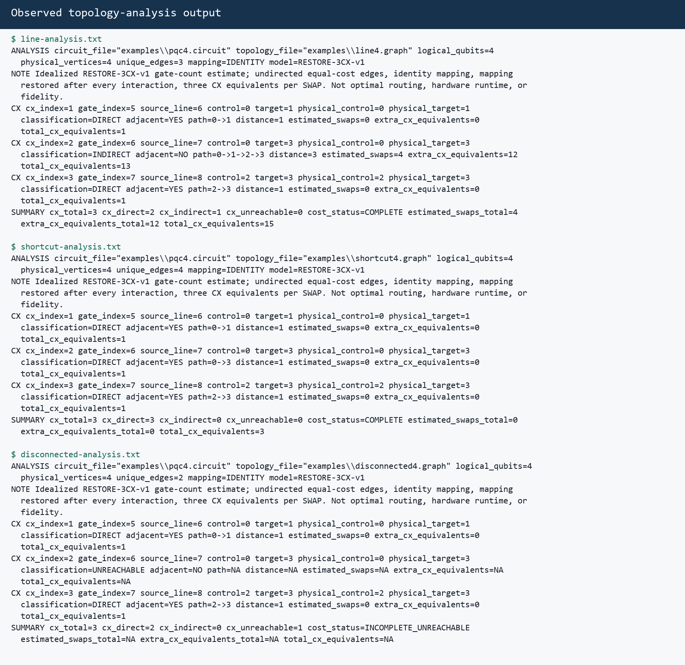
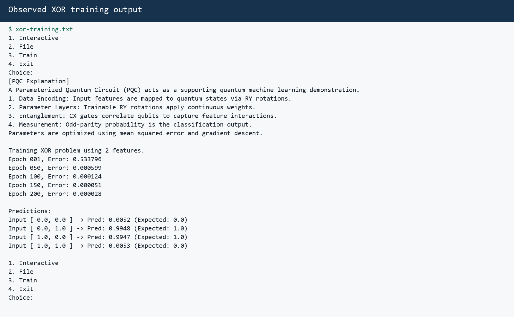

# Graph-Based Hardware-Connectivity and Routing-Cost Analyzer for Parameterized Quantum Circuits

**Project ID:** PQC-GRAPH-C  
**Course context:** Second-year B.Tech AIML, Data Structures laboratory mini-project  
**Implementation language:** C11  
**Evidence date:** 22 October 2026 (Asia/Calcutta)

## 1. Problem Statement

A logical quantum circuit states which qubits interact, but a physical device permits a two-qubit gate only between connected hardware qubits. A logically valid CX can therefore require routing work when its mapped qubits are not adjacent, or can be unavailable when the hardware graph is disconnected.

This project implements a C11 application that reads one validated, ordered parameterized quantum circuit and a physical-connectivity graph. It extracts the circuit's actual CX occurrences, finds deterministic shortest paths with breadth-first search (BFS), and reports an idealized routing-cost estimate. The same logical circuit can also be executed by the retained ideal statevector simulator. The analyzer does not claim to be a transpiler, an optimal router, or a predictor of real-device timing, noise, fidelity, or success probability.

## 2. Motivation

The project joins course-level data structures with a concrete quantum-computing constraint. An adjacency list models sparse hardware connectivity; BFS answers whether two mapped qubits are connected and supplies a shortest path; linked lists, arrays, queues, structs, dynamic memory, and explicit ownership are all exercised in one explainable program.

The comparison is useful because the logical workload remains identical while only the graph changes. This isolates the effect of connectivity: a single shortcut removes the estimated routing overhead for the example's long-range CX, while a disconnected graph makes the complete cost unavailable.

## 3. Objectives

The implemented objectives are:

1. Preserve the original four menu choices: interactive simulation, file simulation, XOR/PQC training, and exit.
2. Represent a validated circuit as one ordered `Circuit` with source-line provenance.
3. Represent physical connectivity as an undirected, duplicate-free, sorted adjacency list.
4. Use deterministic BFS to reconstruct shortest paths and report unreachable pairs explicitly.
5. Extract every real CX occurrence, including repetitions and original control/target roles.
6. Apply the documented `RESTORE-3CX-v1` cost model without claiming optimal routing.
7. Keep analysis independent of statevector allocation and support analysis up to 30 logical qubits.
8. Propagate errors explicitly, validate complete files before execution, and clean up owned memory on failure.
9. Verify the simulator numerically, including compensated accumulation and 20-qubit cases.
10. Supply reproducible tests, real output evidence, this report, and a runnable React presentation.

## 4. Methodology / Implementation

### 4.1 Architecture

The original single-file program was migrated into the approved modules:

| Module | Responsibility |
|---|---|
| `common.c/.h` | Status codes, diagnostics, checked size arithmetic, allocation wrappers and test accounting |
| `circuit.c/.h` | Gate definitions, ordered operations, source lines, validation, ownership |
| `input.c/.h` | Strict bounded parsers, complete circuit/topology loaders, interactive line input |
| `graph.c/.h` | Sorted undirected adjacency lists, duplicate handling, adjacency queries, BFS paths |
| `analysis.c/.h` | CX extraction, identity mapping, classification, cost records and totals |
| `sim.c/.h` | Ideal little-endian statevector and the six supported gates |
| `qml.c/.h` | Production PQC forward path, encoding-only control and XOR trainer |
| `a.c` | Menu, CLI dispatch, workflow ownership, diagnostics and report serialization |

The circuit, graph, analyzer and simulator are separate. The analyzer never creates a statevector, and the simulator/QML modules do not depend on graph or routing code.

### 4.2 Data structures and ownership

`Circuit` owns a dynamically growing `Operation` array. Each operation stores a `Gate` and its physical source line. Capacity begins at 16, doubles safely, and stops at 10,000 gates. An append either succeeds completely or leaves the old pointer, count, capacity and bytes unchanged.

`Graph` owns an array of adjacency-list heads. Every undirected edge owns two linked-list nodes. Lists remain sorted by neighbor ID, making BFS deterministic regardless of edge input order. Duplicate reversed edges are accepted once and reported as warnings by the input layer.

`Analysis` owns an exact-length array of CX result rows. Paths are fixed-size inline arrays, so destruction requires only one row-array free. `SimState` owns one amplitude array. Every owning type has an idempotent destroy function.

### 4.3 Validation and atomic file loading

Files are opened in binary mode and bounded to 1,048,576 bytes. The loader accepts LF, CRLF and a final unterminated line, but rejects overlong lines, embedded NUL, BOM, bare CR, unsupported control bytes, trailing tokens, unknown/lowercase gates, invalid operands, self-CX, malformed angles, and nonfinite or out-of-range numeric values.

The entire file is parsed into a temporary owner. Only a fully valid circuit or graph is transferred to the caller. Therefore a malformed late gate cannot execute an earlier valid prefix.

### 4.4 Deterministic BFS

BFS uses direct local arrays `visited[64]`, `queue[64]`, and `parent[64]`. A vertex is marked when enqueued, and neighbors are visited in ascending order. A reachable path is reconstructed from target to source and then reversed. An unreachable path is a successful graph query with `reachable=false`; it is not assigned a fake distance.

For a graph with `V` vertices and `E` edges, each query is `O(V+E)` time and `O(V)` auxiliary space. Adjacency-list storage is `O(V+E)`.

## 5. Hardware / Software Used

### Software

- Windows 10-compatible environment (`10.0.26200.0`).
- GCC 13.2.0, MinGW-w64, using `-std=c11 -Wall -Wextra -Wpedantic -O2`.
- GNU Make 4.4.1 (`mingw32-make`).
- Python 3.12.6 standard library for CLI/reference tests; Pillow 10.2.0 only renders evidence PNGs.
- Node.js/npm and Vite + React for the presentation.
- No quantum SDK, GPU library, network service, or third-party C runtime dependency.

### Resource bounds

- Circuit analysis: 1–30 logical qubits and at most 10,000 gates.
- Ideal file simulation: 1–20 qubits; interactive simulation: 1–10.
- Graph: 1–64 vertices and at most 10,000 raw edge rows.
- Text file: at most 1 MiB; content line: at most 255 bytes.

The 20-qubit statevector contains `2^20` complex amplitudes (about 16 MiB for two 8-byte doubles per amplitude).

## 6. Algorithm / Operations Implemented

### 6.1 Supported gates

The ideal simulator implements `X`, `H`, `RX`, `RY`, `RZ`, and `CX` with qubit 0 as the least-significant state index bit. It preserves the original arithmetic and parameter order. Squared norm and odd-parity probability use Kahan compensated summation. A nonfinite, zero, or out-of-tolerance state produces `E_NUMERIC`; it is not treated as probability zero.

### 6.2 CX extraction and classification

The analyzer scans the ordered `Circuit` once and creates one row per `GATE_CX`. Each row retains CX ordinal, gate ordinal, physical source line, logical control and target, and identity-mapped physical endpoints. Repetitions are not optimized away.

- `DIRECT`: mapped endpoints are adjacent; distance `d=1`.
- `INDIRECT`: endpoints are connected through a path; `d>1`.
- `UNREACHABLE`: no path exists; distance and costs are `NA`.

### 6.3 `RESTORE-3CX-v1`

For a reachable CX at shortest-path distance `d`:

```text
estimated SWAPs       = 2(d - 1)
extra CX equivalents = 3 × SWAPs = 6(d - 1)
total CX equivalents = 1 + 6(d - 1)
```

The strategy conceptually moves the qubits together and restores the identity mapping after each interaction. Each SWAP is counted as three CX equivalents. Costs are exact integer counts. If any CX is unreachable, the three full-workload totals are unavailable rather than misleadingly reported as zero.

### 6.4 XOR/PQC path

The production forward path uses two feature `RY(x_iπ)` rotations, two parameterized `RY` gates, one `CX(0,1)`, two final parameterized `RY` gates, and odd-parity readout. Training retains four ordered XOR examples, four parameters, 200 epochs, learning rate `0.5`, finite-difference epsilon `1e-4`, and the original update order.

The encoding/readout-only control already yields the four XOR labels exactly. This is disclosed because the training and evaluation set is the same four examples; the result is a supporting demonstration, not evidence of generalization.

## 7. Executable Code

From the repository root on this Windows environment:

```powershell
C:\MinGW\bin\mingw32-make.exe all
.\qmlc.exe
.\qmlc.exe --help
.\qmlc.exe --analyze examples\pqc4.circuit --topology examples\line4.graph
C:\MinGW\bin\mingw32-make.exe test
```

On a POSIX system with GCC/Clang, use `make` and `./qmlc`. The React presentation is under `presentation/` and is run with `npm install`, `npm run dev`, or built with `npm run build`.

## 8. Result Analysis with Output Screenshots

### 8.1 Topology comparison

The same `examples/pqc4.circuit` bytes were used in all three commands. Its SHA-256 during evidence capture was `E04F7705FD70C9B7BD08FE2966C4E82C411130E07A55BB3DB1973A7F73E67C53`.

| Topology | Observed CX distances | Observed SWAPs | Observed extra CX | Observed total CX |
|---|---|---:|---:|---:|
| Line `0–1–2–3` | `1, 3, 1` | 4 | 12 | 15 |
| Line plus shortcut `0–3` | `1, 1, 1` | 0 | 0 | 3 |
| Disconnected `{0–1, 2–3}` | `1, NA, 1` | NA | NA | NA |

The line's long-range `CX(0,3)` has distance 3, so it contributes four SWAPs and 13 total CX equivalents by itself. Adding edge `0–3` makes all three CX operations direct. In the disconnected graph, `CX(0,3)` is unreachable; the analyzer still exits successfully but marks the full cost incomplete.



### 8.2 XOR observation

The ordinary menu training run observed losses `0.533796` at epoch 1 and `0.000028` immediately before the epoch-200 update. Its displayed predictions were `0.0052`, `0.9948`, `0.9947`, and `0.0053` for inputs `00`, `01`, `10`, and `11`. The independent reference probe also checks encoding-only, initialized full-PQC, zero-parameter full-PQC, and trained full-PQC paths through production functions.



These values describe this fixed run and these four examples only. No held-out set was used.

### 8.3 Verification evidence

The following command completed successfully after a clean build:

```text
mingw32-make clean
mingw32-make test
```

Observed passing groups were `test_common`, `test_circuit`, `test_graph`, `test_input`, `test_analysis`, `test_sim`, `test_qml`, the 30-qubit analysis-only executable, the independent Python simulator/QML reference, and the complete CLI suite. The CLI suite checks the exact three summaries, both option orders, help and usage statuses, atomic invalid-file behavior, file/line/gate/vertex limits, mapping failure, and the 21-qubit simulation cap. Numerical tests cover Bell behavior, nonfinite/out-of-tolerance rejection, dense and skewed 20-qubit states, and a generated 20-qubit circuit.

The archived baseline verifier's ordinary build and functional probes ran on Windows, but its sanitizer link step could not run because the installed MinGW GCC lacks `libasan` and `libubsan`. The new `make sanitize` target was also attempted with Clang 16 and failed to link because its Windows ASan runtime archives are absent. No WSL distribution is installed. Sanitizer execution is therefore **unavailable**, not reported as passing. Allocation accounting and cleanup are still exercised by injected-failure tests, but that is not a substitute for sanitizer evidence.

The original `baseline-evidence.zip` remains unchanged. New transcripts are generated under ignored `build/evidence/`; the two images above are reproducible renderings of those exact transcripts, not manually invented console text.

## 9. References

1. Project documents DOC-01 through DOC-07 in `docs/`, especially DOC-04 (SRS), DOC-05 v0.2 (design), DOC-06 (implementation order), and DOC-07 (test plan).
2. Original repository baseline commit `eff9baaea6a08c22cd317449a18b89894ef020dd` and immutable `docs/baseline-evidence.zip`.
3. M. A. Nielsen and I. L. Chuang, *Quantum Computation and Quantum Information*, Cambridge University Press.
4. T. H. Cormen et al., *Introduction to Algorithms*, breadth-first search and adjacency-list graph representations.
5. W. Kahan, compensated summation method for reducing floating-point accumulation error.
6. ISO/IEC 9899:2011, C11 language standard.

### Limitations and conclusion

The model assumes undirected equal-cost couplings, identity mapping, a restore-after-each-interaction strategy, and three CX equivalents per SWAP. It does not model directed native gates, calibration, parallel scheduling, noise, fidelity, duration, mapping optimization, or cross-interaction SWAP reuse.

Within those declared assumptions, the project demonstrates the intended relationship clearly: topology changes routing availability and estimated two-qubit-gate cost without changing the logical circuit. The modular C implementation, deterministic BFS, strict validation, explicit ownership and independent tests make the result suitable for code review and viva explanation.

## Appendix: Interactive Demo Lab Extension

The completed core was extended with a local Vite + React teaching interface. Its tracked manifest contains 28 gate, entanglement, topology, QML and negative-input demonstrations. The interface sends bounded input to a localhost-only Node bridge, which invokes the compiled C executable with argument arrays. JavaScript does not reproduce the simulator, BFS, routing equations or trainer.

The extension adds deterministic `--simulate` and `--qml` commands while preserving the original menu. Browser verification covered demo switching, editable topology selection, line and shortcut execution, parsed CX records, real `graph.c` source loading, presentation notes and visible backend errors.

The untouched presentation snapshot created before slide edits is `artifacts/current-presentation-before-changes.pdf`. The earlier compact export is `artifacts/updated-presentation.pdf`, and the final 10-slide faculty briefing is `presentation/final-presentation.pdf`. Complete presenter notes are stored in `presentation/speaker-notes.md`; they remain editable and are intentionally excluded from the PDF pages.
